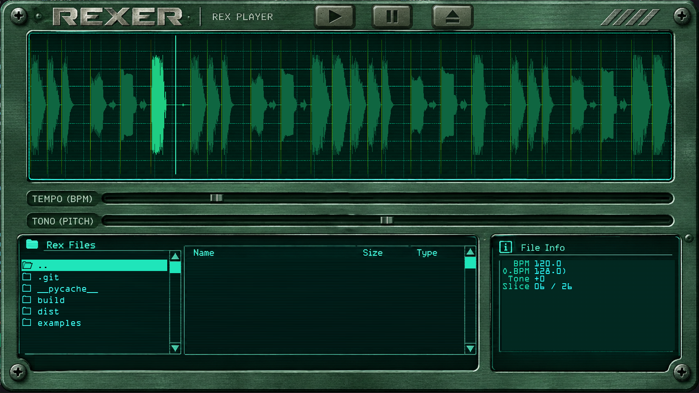

# rexer

**rexer** es un reproductor y procesador de bucles de audio en formato **REX** desarrollado en Python. La aplicación integra un entorno gráfico dedicado junto con un motor de audio para manipular, rebanar (slice) y reproducir loops de manera interactiva.



## Características

* **Compatibilidad con REX:** Diseñado para la lectura y gestión de archivos y componentes REX (`rex.py`, `REX.dll`).
* **Interfaz de Usuario Visual:** Incluye elementos gráficos como perillas, decks y pantallas LCD personalizadas (`ui.py`, `interface.py`, recursos visuales y tipografías TTF/OTF).
* **Motor de Audio Integrado:** Procesamiento y reproducción de audio en tiempo real optimizado para bucles (`audio.py`).
* **Sistema de Archivos:** Gestión integrada para cargar librerías de loops y assets del sistema (`filesys.py`).

## Estructura del Proyecto

El repositorio contiene los siguientes componentes esenciales:

 
* `rexer.py`: Punto de entrada principal para lanzar la aplicación.
* `app.py`: Orquestador de interfaz de usuario, funciones de audio y emulador de REX
* `rex.py`: Lógica central del reproductor y envoltorios para el manejo de bucles.
* `audio.py`: Motor de reproducción de audio y sincronización.
* `ui.py` / `interface.py`: Diseño de la interfaz gráfica de usuario.
* `filesys.py`: Lógica de carga, guardado y navegación por el sistema de archivos.
* `REX.dll`: Biblioteca de enlace dinámico requerida para el procesamiento del formato REX.

## Instalación

1. Clona el repositorio en tu entorno local:
   ```bash
   git clone https://github.com/pinakure/rexer.git
   cd rexer
   ```

2. Instala las dependencias necesarias mediante `requirements.txt`:
   ```bash
   pip install -r requirements.txt
   ```

## Uso

Para arrancar el reproductor REX, ejecuta el script principal:

```bash
python rexer.py
```

Si se especifica un archivo RX2 y un BPM, se cargará directamente.

## Licencia

Este proyecto está liberado bajo la licencia **Unlicense**. Consulta el archivo `LICENSE` para obtener más información sobre el uso libre y sin restricciones de este software.
